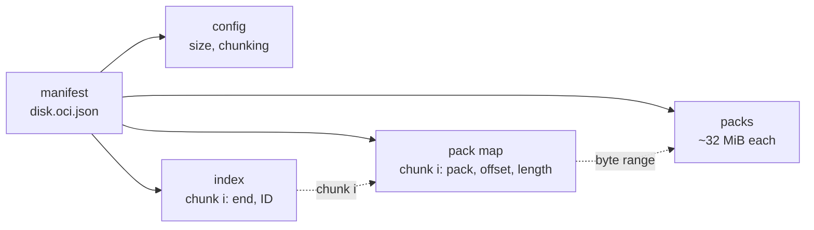
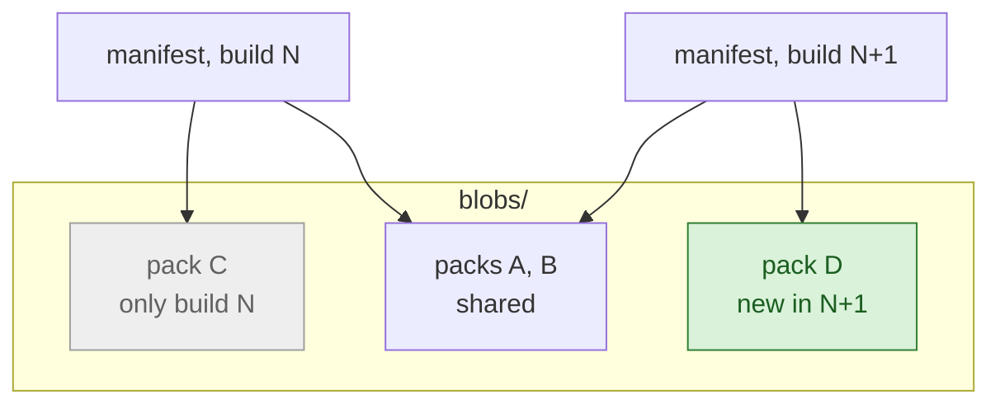
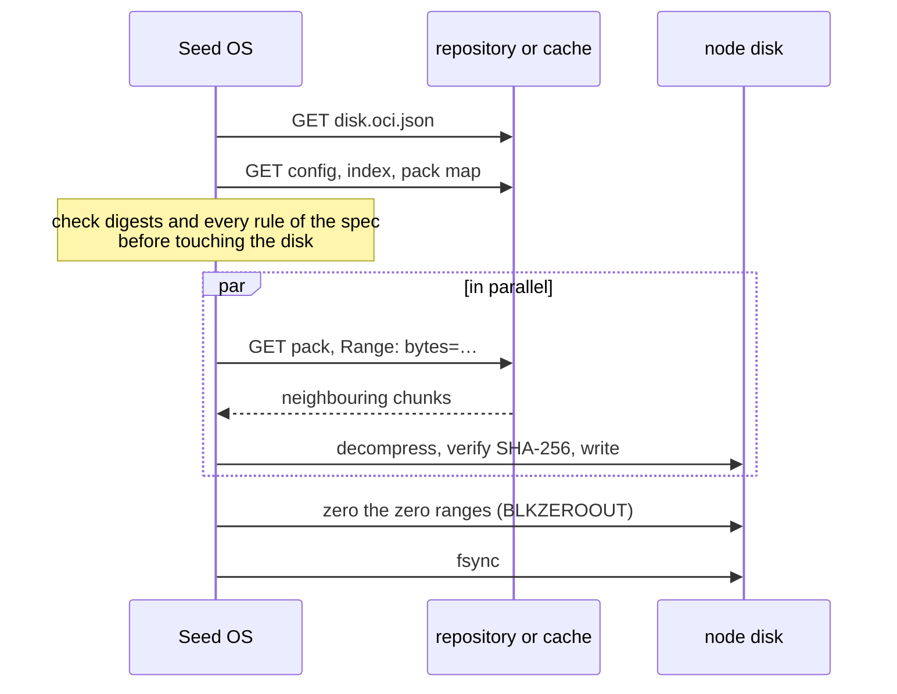

# exordos_image_format

The format in which Exordos ships node disk images: the disk is cut into
chunks, chunks are packed into large immutable files, and a small OCI manifest
says how to put the disk back together.

## Why

Today every build ships a whole-disk `raw.zst`, and every node downloads and
writes all of it, zeros included. Yet two builds of one element differ by a few
percent, and all elements are built on `exordos-base`. Nothing in the delivery
path used that.

Measured on real images: `exordos-base` 1.3.3 and 1.3.4, and two consecutive
builds of the s3-dp element (a 6 GiB disk with 2.9 GiB of data).

### Releases are 9–40 times smaller

What a build adds to the repository, and what every cache has to fetch again:

Build | `raw.zst` | Chunks | Gain
--- | --- | --- | ---
s3-dp, next build | 909 MiB | 22.5 MiB | 40×
s3-dp on top of the base | 909 MiB | 185 MiB | 5×
Base 1.3.3 → 1.3.4 | 738 MiB | 83 MiB | 9×

Two consecutive s3-dp builds share 34 of their 35 packs. Rolling out the new
build sends one 21 MiB pack from the origin to each cache, instead of a new
909 MiB file that misses every cache.

### Flashing is faster

Seed OS flashing s3-dp onto an empty disk, median of runs:

Link | `raw.zst` | Chunks
--- | --- | ---
No limit | 13.3 s | 4.2 s
1 Gbit/s, 5 ms RTT | 13.9 s | ~9 s
100 Mbit/s, 5 ms RTT | 82.3 s | about the same

`raw.zst` is bound by one core decompressing and writing all 6 GiB, not by the
network. Chunks skip the 3.1 GiB of zeros and are fetched and decompressed in
parallel. On a slow link the size decides, and a full chunked image is about
as large as `raw.zst` (967 vs 909 MiB). A cache next to the hypervisors helps
there most.

### Why not block deltas

`zfs send -i`, `zstream raw` or qcow2 overlays ship changes by block offset.
Every rebuild reinstalls packages on a fresh base, and the filesystem puts the
same files at other offsets:

Transition | Delta by offset | Delta by content
--- | --- | ---
s3-dp build N → N+1 | 137 MiB | ~1 MiB
Base 1.3.3 → 1.3.4 | 359 MiB | 48 MiB

Offset deltas also need the target to hold exactly the old snapshot, and a
running node's disk no longer does.

## How it works

### An image



- **Index**: the list of chunks in disk order, each with its end offset and
  chunk ID (the SHA-256 of its data). Boundaries depend on content, so an
  insertion shifts only nearby chunks.
- **Pack**: compressed chunks back to back, about 32 MiB. Packs never change
  and are shared between images.
- **Pack map**: for each chunk, where it is: a byte range in a pack, or
  "zeros", stored nowhere.
- **Config** and **manifest**: image size, chunking parameters, and the list of
  all objects with their digests.

On the disk:

```text
disk       | data A | zeros | zeros | data B | data A | data C |
index        c1       z       z       c2       c1       c3
pack map     pack1@0  zero    zero    pack1@7k pack1@0  pack2@0
```

A repeated chunk (`c1`) is stored and fetched once. Zero chunks are not stored
at all.

### A new release



The builder chunks the new disk and looks up every chunk in the previous
version and in the base image. Known chunks are referenced where they already
are, and only new ones go into new packs. A cache in front of the repository
already holds packs A and B and fetches only D. C stays for as long as build
N is published.

### A flash



Every byte written is verified: chunk IDs come from the index, the index is
verified by its digest in the manifest.

### Where it lives

In a static repository (nginx or a directory), the image is a sidecar of the
usual `raw.zst`, and all blobs sit in one shared directory:

```text
<repository>/blobs/sha256/<hex>                         packs, indexes, pack maps, configs
<repository>/<element>/<version>/images/disk.raw.zst    whole image, as before
<repository>/<element>/<version>/images/disk.oci.json   manifest of the chunked image
```

The core and element manifests do not change: they still point to `raw.zst`.
Seed OS looks for `disk.oci.json` next to it and falls back to `raw.zst` if it
is not there. The same objects can be pushed to an OCI registry as a regular
artifact.

## What is standard and what is ours

Part | Where it comes from
--- | ---
Manifest, descriptors, digests, `blobs/sha256/` | OCI image-spec 1.1
Index (`.caibx`), content-defined chunking | casync / desync, readable by `desync`
Compressed chunk | a zstd frame, the same as a casync `.cacnk` file
Packs, pack map, config, zero chunks | this repository

## What is in this repository

- [SPEC.md](SPEC.md): the specification. Byte
  layouts, and the rules a reader must check before writing, each with an
  error code.
- [vectors/](vectors/README.md): conformance vectors. A small repository with 3
  valid images and 27 images that break one rule each. `exordos build` and
  Seed OS run them in their tests.
- `exordos_image_format`: the reference implementation on the Python 3.14
  standard library.

## Reference implementation

It reads and writes static repositories, from a directory or over HTTP. The OCI
registry binding is specified but not implemented yet.

```bash
# Validate an image, optionally with every chunk
python3.14 -m exordos_image_format check [--chunks] <path or URL of <name>.oci.json>

# Write the raw image to a file or a block device
python3.14 -m exordos_image_format extract <sidecar> <target>

# Build an image into a static repository, reusing the packs of references
python3.14 -m exordos_image_format build disk.raw repo/disk/1.0.0/images/disk.oci.json \
    --blobs repo/blobs [--reference <sidecar>]... [--title disk --version 1.0.0]
```

`build` chunks the image with `desync` unless `--index` gives a `.caibx`.

Modules:

- `format`: objects and codecs; `load_image()` checks every rule a reader must
  check before writing, `decode_chunk()` verifies a chunk.
- `repository`: static repositories, `extract()` and `verify_chunks()`.
- `writer`: building images and sidecars.

## Development

```bash
tox -e py314        # tests; with desync in PATH also the desync compatibility tests
tox -e ruff         # format and fix
tox -e ruff-check
python3.14 vectors/generate.py   # regenerate the vectors, needs desync
```

Measurements, design decisions and alternatives are in the `exordos`
repository, `docs/disk-image-format.md`.
